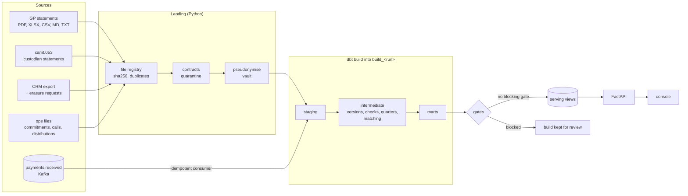

# Design

## The flow of one run

`pmd.flow.TASKS` declares these steps once. `pmd run` executes them in order under an advisory lock; the
Airflow DAG in `dags/` is generated from the same list, with Airflow's run id as the build schema.

## Layers

- **raw**: what arrived, typed, one row per source row, each with its file id. Nothing is updated in place.
- **pii**: the vault. Only `pmd_operations` reaches it, and only through `pmd_util.reveal_client`.
- **ops**: the platform's own records: files, quarantine, dead events, runs, break actions, statement
  releases, erasure decisions, the reveal log, the key fingerprint.
- **build_<run>**: one dbt build. Staging renames and casts; intermediate does the work (statement versions
  and checks, fund and feeder quarters, expected payments, receipt matching); marts are what people read.
- **serving**: views over the last published build. The API reads nothing else from the warehouse.

## Statements

The parser turns any statement into cells (table cells, `label: value` lines, dot leaders, wide columns),
classifies each label against the vocabulary, and picks the cumulative and closing figures over the period and
opening ones. Units are read from the statement (`TEUR`, `in thousands`, `Mio.`); German and English number
formats are told apart by their separators. A statement that misses a required field, has a period end that
is not a quarter end, pays in more than its commitment, or holds several funds is quarantined with the rule
that failed.

Read statements then go through the checks in `int_statement_checks`: commitment against the agreed one,
cumulative figures that fall, and a NAV move that the quarter's calls and distributions do not explain (above
40 %). A failing statement is held; its quarter is estimated until fund accounting releases it or the manager
sends a new version.

## Money

Expected payments come from the ops call file and the commitments. A receipt is matched by its reference (call
and client key) when the payer's account is the client's own; otherwise by the payer's account for an open
call; otherwise it is unmatched. The comparison of expected with received gives paid, part paid, short, over,
duplicate (a second payment within the window), late and overdue, each with the tolerance and grace days in
`config/platform.yaml`. Breaks get an md5 id from their kind, client and reference, so a break keeps its id and
its actions across runs. The instant feed adds money that has arrived but is not yet on a custodian statement;
it is shown as provisional and never counted as booked.

## Gates

| Gate | Stops publishing | What it checks |
| --- | --- | --- |
| dbt_tests | yes | every model built and every test passed |
| marts_not_empty | yes | no client-facing mart is empty |
| nav_drift | yes, approvable | no fund NAV moved more than 25 % against the published build without a new statement |
| unmatched_receipts | warns | no receipt unplaced for more than 10 days |
| overdue_calls | warns | no capital call payment overdue |
| late_statements | warns | no statement past its due date |
| statement_holds | warns | no statement held by its checks |

## Truth isolation

`data/truth` is read only by `src/pmd/evaluate.py`; the held-out answers only by `src/pmd/heldout.py`.
`tests/test_isolation.py` fails if any other module imports the simulator or opens the truth.
